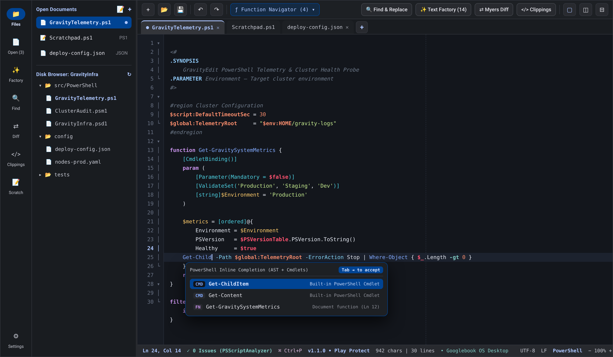
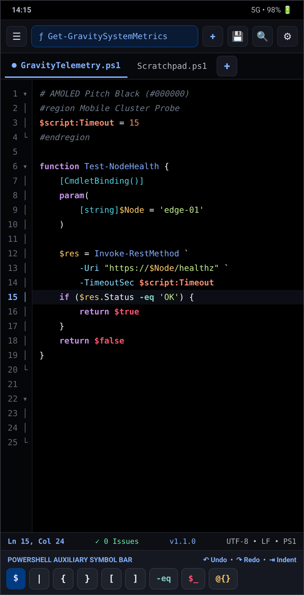
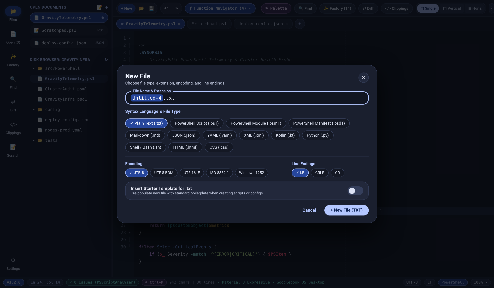
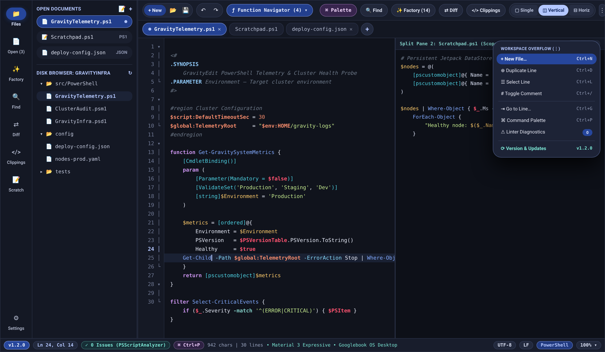
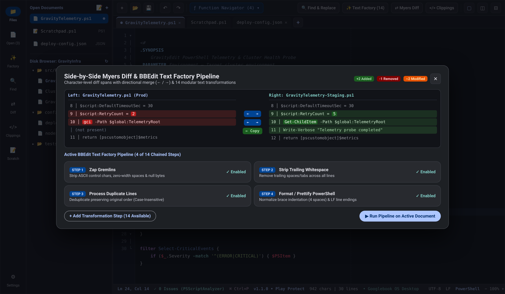
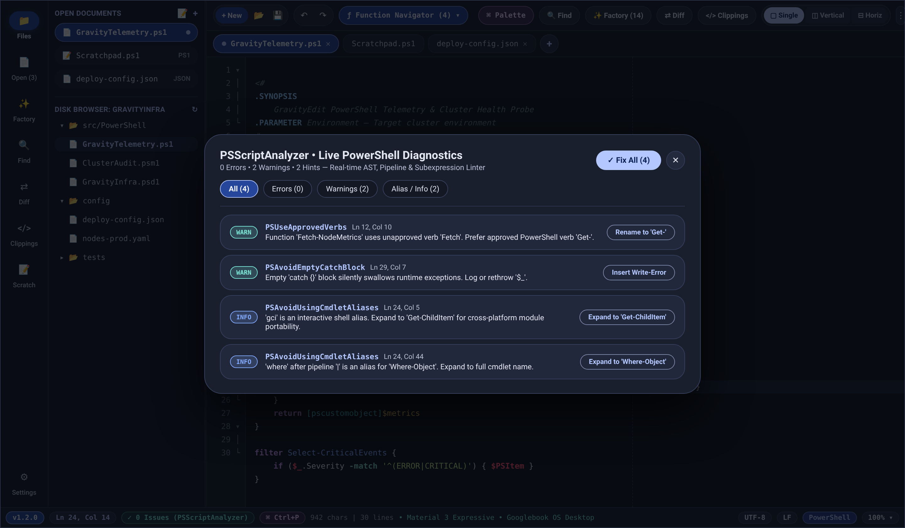
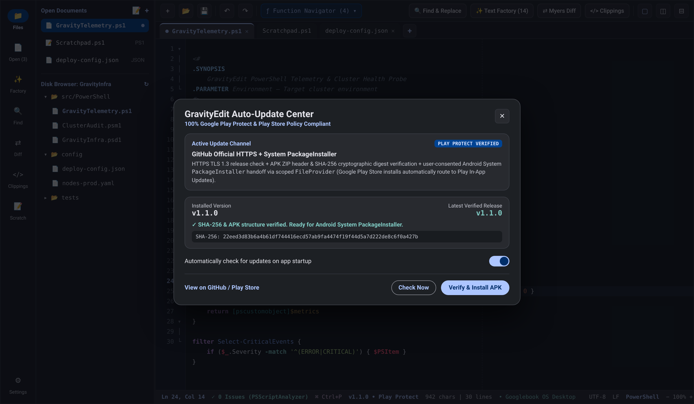

<div align="center">

# GravityEdit

**The 1:1 PowerShell-First BBEdit Workbench — Engineered Natively for macOS (Apple Liquid Glass) and Googlebook OS & Android (Material 3 Expressive)**

[](https://github.com/petrosvassiliou/GravityEdit/releases/latest)
[](https://github.com/petrosvassiliou/GravityEdit/actions/workflows/macos-ci.yml)
[](https://github.com/petrosvassiliou/GravityEdit/actions/workflows/android-ci.yml)
[-007AFF?style=for-the-badge&logo=swift&logoColor=white)](#macos-edition-apple-liquid-glass--sparkle-2-auto-updates)
[](#android--googlebook-os-edition-material-3-expressive)

<p align="center">
  <a href="https://github.com/petrosvassiliou/GravityEdit/releases/latest"><strong>⬇ Download macOS DMG &amp; Android APK (v1.3.3)</strong></a>
  &nbsp;•&nbsp;
  <a href="#macos-edition-apple-liquid-glass--sparkle-2-auto-updates">macOS Liquid Glass</a>
  &nbsp;•&nbsp;
  <a href="#screenshots">Screenshots</a>
  &nbsp;•&nbsp;
  <a href="#key-features">Key Features</a>
  &nbsp;•&nbsp;
  <a href="#keyboard-shortcuts">Shortcuts</a>
  &nbsp;•&nbsp;
  <a href="#building-from-source">Build from Source</a>
</p>

</div>

---

## Overview

**GravityEdit** brings the rock-solid text engineering philosophy of **BBEdit** (*zero bloat, instant startup, industrial PCRE regex, deterministic text pipelines*) paired with a **first-class PowerShell AST, syntax, inline completion, and `PSScriptAnalyzer`-grade diagnostic engine** to two native desktop & mobile ecosystems:

1. **GravityEdit for macOS (`com.gravityedit.mac`)** — 100% native **Swift, SwiftUI, and AppKit (`NSTextView` + `NSRulerView`)** engineered for **macOS 26 Tahoe Liquid Glass** (with graceful vibrancy fallback on macOS 15 Sequoia), full Apple Human Interface Guidelines compliance, native Menu Bar commands, and **in-app automatic updates** powered by **Sparkle 2 + CryptoKit SHA-256**.
2. **GravityEdit for Googlebook OS & Android (`com.gravityedit.app`)** — 100% native **Kotlin & Jetpack Compose (Material 3 Expressive)** with adaptive freeform desktop/tablet/mobile layouts and **Google Play Protect–compliant (`0` sensitive permissions)** update verification.

---

## macOS Edition (Apple Liquid Glass & Sparkle 2 Auto-Updates)

### Apple Liquid Glass & Human Interface Guidelines Architecture
- **Navigation-Only Liquid Glass Layer:** Uses SwiftUI 26 `GlassEffectContainer`, `.glassEffect(.regular, in:)`, `.glassEffectID(_:in:)`, `.buttonStyle(.glass)`, and `.buttonStyle(.glassProminent)` on the floating `NavigationSplitView` sidebar, unified window toolbar, morphing document tab capsules, bottom status pills, Command Palette (`⇧⌘P`), and inline PowerShell completion card — while keeping the **AppKit `NSTextView` code canvas strictly opaque and high-contrast** (`Daylight Crisp`, `Tahoe Midnight`, `Pitch-Black Pro`) per Apple HIG (*"Never use Liquid Glass in the content layer"*).
- **Full Accessibility Compliance:** Automatically adapts to macOS `Reduce Transparency`, `Reduce Motion`, and `Increase Contrast` system settings.
- **Native macOS Menu Bar & Keyboard Equivalents:** Complete macOS Menu Bar (`GravityEdit` → `About`, `Settings…` `⌘,`, `Check for Updates…` `⌥⌘U`; `File`; `Edit`; `Search`; **`Text` exposing all 14 BBEdit transformations directly in the menu bar**; `View`; `Tools`; `Help`), native `NSOpenPanel` / `NSSavePanel`, Dock drag-and-drop file/folder opening, and unsaved-document close/quit confirmation (`NSAlert`).
- **In-App Automatic Updates:** Integrates **Sparkle 2 (`SPUStandardUpdaterController` + `appcast.xml`)** alongside a built-in **Liquid Glass Software Update sheet** (accessible from the menu bar or by clicking the bottom-left **`v1.3.3`** pill) that checks `petrosvassiliou/GravityEdit` releases in the background, verifies `.app.zip` archives against published **SHA-256** manifests via Apple `CryptoKit`, atomically swaps `GravityEdit.app`, and relaunches automatically.

---

## What's New in v1.3.3

- **Cross-Platform End-to-End Smoke Audit & Polish (`v1.3.3`):**
  - **macOS Native Undo/Redo (`⌘Z` / `⇧⌘Z`) & Selection Continuity:** Registered all programmatic edits (BBEdit Text Factory, Replace All, Quick Fixes, Encoding/Base64/URL utilities, Diff Merge, Clippings) onto `NSTextView`'s `NSUndoManager` while preserving selection spans, scratchpad persistence, and unsaved-quit guards during in-app updates.
  - **Complete 14-Item BBEdit `Text` Menu, Sheet & Keyboard Navigation Polish:** Exposed all **14 of 14** BBEdit operations directly in the macOS `Text` menu bar, added `Scope` (`Selection` / `Active Document` / `All Open Documents`) to Text Factory, added `Swap` + character-level diff highlights to Side-by-Side Diff, added `↑` / `↓` / `Return` / `Escape` navigation to Command Palette (`⇧⌘P`), and excluded string literals when highlighting comments in Swift/Kotlin/Python/YAML/Shell.
  - **PowerShell Alias Boundary & Formatter Hardening:** Enforced pipeline/command boundary matching on `%` and `?` in Canonize so `"100%"`, `"$?"`, and URLs are never corrupted, and prioritized `.powershell` language over `[`...`]` JSON heuristics in `Format / Prettify`.
  - **Android & Googlebook OS Hardening:** Filtered multi-platform GitHub release assets strictly for `.apk`, synchronized file extensions when switching syntax language, added `Swap (⇄)` + horizontal scrolling to Side-by-Side Diff, added custom clipping deletion, and accelerated Myers Diff on 1,000+ line files via common prefix/suffix trimming.
- **macOS Liquid Glass UI & TextKit 1 Code Canvas (`v1.3.2`):** Finite `1.0e7` TextKit 1 canvas geometry, right-aligned detail-column titlebar with `40pt` Liquid Glass tab bar, and unclipped split-view toolbar capsules.
- **Enhanced PowerShell Function & Procedural Script Navigator (`Funktionsnavigator`):** Extracts multi-line `param(...)` parameter signatures on advanced functions, Unicode/German umlaut names, `$Var = { ... }` scriptblocks (`$sb`), `prm`, `pipe`, `# === ... ===` / box / `# Step N:` section headers (`#sec`), and automatic procedural landmarks (`var`, `tbl`, `blk`) for linear admin scripts without `function` blocks.

---

## Screenshots

### 1. Googlebook OS / Tablet Desktop Workbench (Material 3 Expressive)
Full desktop layout featuring the Expressive `NavigationRail`, drag-resizable **Open Documents & SAF Disk Browser** sidebar, tonal action clusters, **Connected Split-Mode Button Group** (`Single | Vertical | Horizontal`), **Morphing Pill Tab Bar**, **80-column page guide**, **PowerShell Inline Completion (`Tab`)**, and full-width **Expressive Status Bar**.



---

### 2. Adaptive Mobile AMOLED (`#000000`) & `28dp` Expressive File Type Selector

<table>
  <tr>
    <td width="34%" valign="top">
      <h4 align="center">Android Mobile AMOLED Mode</h4>
      <p align="center">
        
      </p>
      <p>
        True <code>#000000</code> Pitch-Black OLED theme, Expressive morphing pill tabs with trailing <code>+</code> button, <code>⋮</code> overflow menu, <strong>Sticky PowerShell Auxiliary Symbol Row</strong>, and bottom-left version pill.
      </p>
    </td>
    <td width="66%" valign="top">
      <h4 align="center">New File Dialog &amp; Stem-Only Rename</h4>
      <p align="center">
        
      </p>
      <p>
        Create Plain Text (<code>.txt</code>), PowerShell (<code>.ps1</code> / <code>.psm1</code> / <code>.psd1</code>), Swift (<code>.swift</code>), Markdown, JSON, YAML, XML, Kotlin, Python, Shell, or HTML/CSS documents with explicit encoding, line endings, and starter templates.
      </p>
    </td>
  </tr>
</table>

---

### 3. Split-View Workspace, Side-by-Side Myers Diff & 14-Step BBEdit Text Factory





---

### 4. Live `PSScriptAnalyzer` Diagnostics & Auto-Update Center

<table>
  <tr>
    <td width="50%" valign="top">
      <h4 align="center">Live PSScriptAnalyzer Linter &amp; Quick Fixes</h4>
      <p align="center">
        
      </p>
      <p>
        Real-time PowerShell static analysis catching unapproved verbs, interactive shell aliases across pipelines and subexpressions (<code>gci | where</code>), plaintext credentials, and empty <code>catch {}</code> blocks — with one-click <strong>Quick Fixes</strong> and <strong>Fix All</strong>.
      </p>
    </td>
    <td width="50%" valign="top">
      <h4 align="center">Cryptographically Verified Software Updates</h4>
      <p align="center">
        
      </p>
      <p>
        Accessible anytime by clicking the bottom-left <code>v1.3.0</code> pill. Uses Sparkle 2 + CryptoKit SHA-256 in-app bundle updates on macOS, and Play Protect–clean trusted browser/Play Store routing on Android.
      </p>
    </td>
  </tr>
</table>

---

## Key Features (1:1 Parity Across macOS & Android / Googlebook OS)

1. **First-Class PowerShell Engine (`PowerShellEngine.swift` / `PowerShellEngine.kt`):**
   - Full PowerShell syntax tokenizer (`ApprovedVerbs`, aliases, `$env:`/`$script:`/`$_` variables, `-Parameters`, `-Operators`, `"$(...)"` interpolation, `@"..."@` here-strings, `<# .SYNOPSIS #>` help tags).
   - Code Folding (`function`, `filter`, `workflow`, `class`, `$Var = { ... }`, `@(`/`@{`, control blocks, `#region`, `<#...#>`).
   - AST & Procedural Function Navigator (`fn`, `flt`, `wf`, `cls`, `cfg`, `$sb`, `prm`, `pipe`, `#sec`, `#reg`, `var`, `tbl`, `blk`) + Swift, Python, Kotlin, Shell/Zsh, and Markdown outlines.
   - Inline Auto-Completion (`Tab` / `⌥Space`) and live `PSScriptAnalyzer` linter with 1-click Quick Fixes & Fix All.
2. **All 14 BBEdit Text Factory Transformations (`TextTransformEngine`):**
   - Zap Gremlins • Process Duplicate Lines • Sort Lines (Ascending/Descending/Numeric/Regex) • Prefix/Suffix Lines • Change Case (`UPPER`, `lower`, `Title Case`, `Sentence case`, `camelCase`, `snake_case`, `iNVERT`) • Strip Trailing Whitespace • Entab/Detab • Hard Wrap & Unwrap • Add/Remove Line Numbers • Educate/Straighten Quotes • Canonize Batch Replace Table • Process Lines Containing • Convert Line Endings (`LF`/`CRLF`/`CR`) • Format/Prettify PowerShell, JSON & XML (+ Base64 & URL Encode/Decode).
3. **Industrial PCRE Find & Replace, Multi-File Search, Regex Playground & Extract Matches.**
4. **Side-by-Side Myers Diff with Intra-Line Highlights & Directional (`←` / `→`) Hunk Merging.**
5. **Clippings Library (`#SELECTION#`, `#INSERTION#`, `#SELSTART#`..`#SELEND#`, `#DATE#`, `#TIME#`, `#FILENAME#`, `#USERNAME#`), Persistent Scratchpad & 6-Language Localization (`en`, `de`, `it`, `es`, `fr`, `el`).**

---

## Keyboard Shortcuts

| Action | macOS Shortcut | Googlebook OS / Android Shortcut |
| :--- | :--- | :--- |
| Command Palette | `⇧⌘P` | `Ctrl + P` / `Ctrl + Shift + P` |
| New Document | `⌘N` (`⇧⌘N` Quick `.ps1`) | `Ctrl + N` |
| Open File / Mount Folder | `⌘O` / `⇧⌘O` | `Ctrl + O` |
| Save / Save As | `⌘S` / `⇧⌘S` | `Ctrl + S` / `Ctrl + Shift + S` |
| Close Active Tab | `⌘W` | `Ctrl + W` |
| Find & Replace / Multi-File Search | `⌘F` / `⇧⌘F` | `Ctrl + F` / `Ctrl + Shift + F` |
| Open BBEdit Text Factory | `⇧⌘T` | `Ctrl + Shift + T` |
| Format / Prettify Document | `⌃⌥F` | `Alt + Shift + F` |
| Compare Documents (Myers Diff) | `⌃⌘D` | `Ctrl + Alt + D` |
| Go to Line / Jump to Function | `⌃L` / `⌘J` | `Ctrl + G` / `Ctrl + J` |
| Duplicate Line / Select Line | `⌘D` / `⌘L` | `Ctrl + D` / `Ctrl + L` |
| Toggle Comment / Indent / Outdent | `⌘/` • `⌘]` • `⌘[` | `Ctrl + /` • `Tab` • `Shift + Tab` |
| Split View (Single / Vertical / Horizontal) | `⌥⌘1` • `⌥⌘2` • `⌥⌘3` | Connected Split Toolbar |
| Check for Software Updates | `⌥⌘U` (or `v1.3.0` pill) | Tap `v1.3.0` pill |
| Settings | `⌘,` | Sidebar / Overflow Settings |

---

## Repository Structure

```text
GravityEdit/
├── macos/                                     # Native macOS Edition (SwiftUI Liquid Glass + AppKit + Sparkle 2)
│   ├── Package.swift                          # SwiftPM manifest (GravityEditCore, GravityEditMac, Tests)
│   ├── Sources/
│   │   ├── GravityEditCore/                   # Cross-module engines (PowerShell, Regex, TextFactory, Diff, Clippings, AutoUpdate, L10n)
│   │   └── GravityEditMac/                    # LiquidGlassDesignSystem, SparkleUpdateManager, NSTextView editor, Views & Menu Commands
│   ├── Tests/GravityEditCoreTests/            # XCTest suite
│   └── scripts/                               # generate_icon.swift & package_app.sh (.app, .dmg, .app.zip, appcast.xml)
├── app/                                       # Native Android & Googlebook OS Edition (Kotlin + Compose Material 3 Expressive)
└── .github/workflows/
    ├── macos-ci.yml                           # Xcode 26 (macos-26) XCTest + Universal .dmg/.app.zip/appcast release pipeline
    └── android-ci.yml                         # JDK 17 JUnit + Signed v1/v2/v3 APK release pipeline
```

---

## Installation

### macOS (macOS 26 Tahoe Liquid Glass & macOS 15 Sequoia+)
1. Download **`GravityEdit-macOS-v1.3.3.dmg`** from [**GitHub Releases**](https://github.com/petrosvassiliou/GravityEdit/releases/latest).
2. Open the disk image and drag **`GravityEdit.app`** to **`/Applications`**.
3. *(First launch without Apple Notarization)* If macOS Gatekeeper prompts on an unsigned/ad-hoc GitHub build, Control-click **`GravityEdit.app`** → **Open** (or run `xattr -dr com.apple.quarantine /Applications/GravityEdit.app`). Subsequent updates can be installed directly inside the app via **GravityEdit → Check for Updates…** (`⌥⌘U`)!

### Android & Googlebook OS (Android 8.0+ / API 26+)
1. Download **`GravityEdit-v1.3.3.apk`** from [**GitHub Releases**](https://github.com/petrosvassiliou/GravityEdit/releases/latest) and open to install or upgrade in-place.

---

## Building from Source

### macOS (Xcode 26+ / Swift 6+)
```bash
cd macos

# Run the XCTest unit test suite
swift test

# Build & package GravityEdit.app, .dmg, .app.zip, .sha256 & Sparkle appcast.xml
./scripts/package_app.sh 1.3.3
```

### Android & Googlebook OS (JDK 17 + Android SDK 35)
```bash
./gradlew testDebugUnitTest assembleRelease
```
