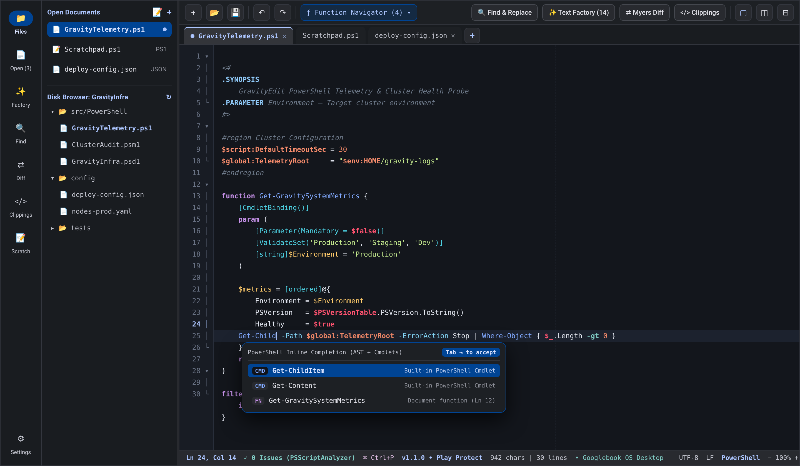
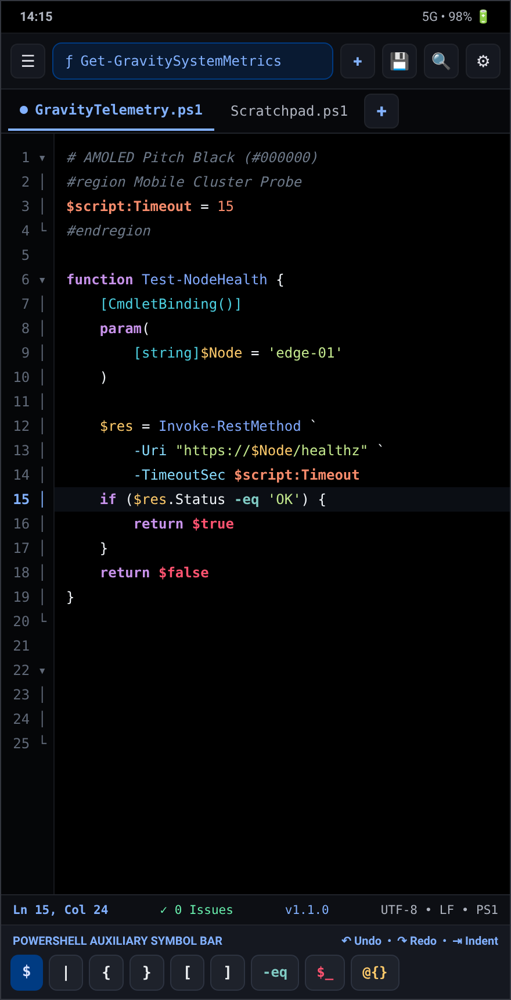
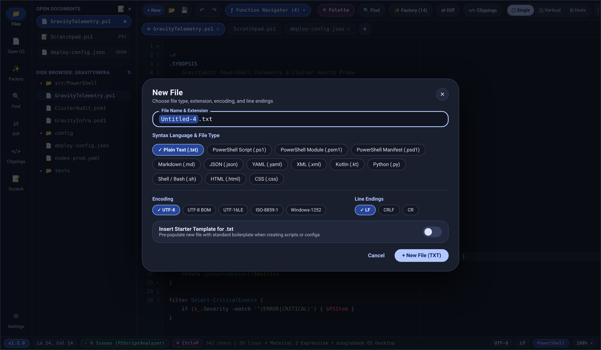
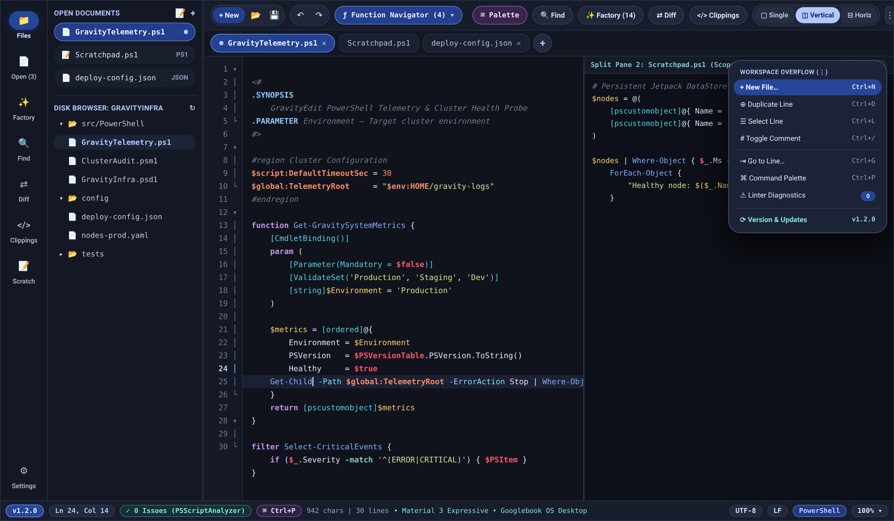
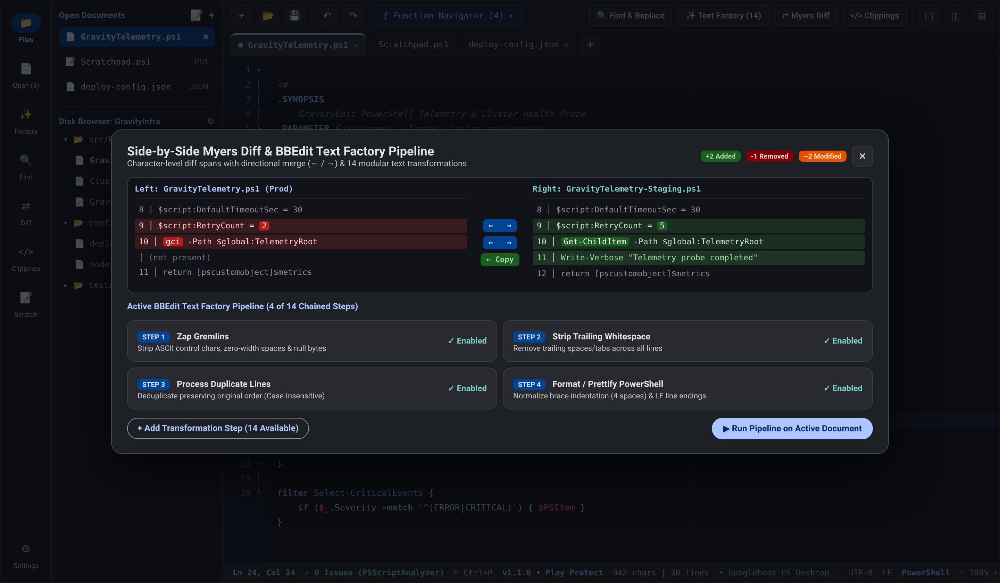
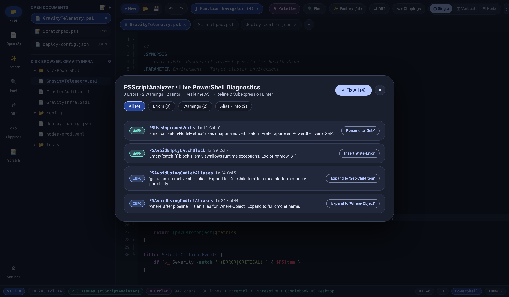
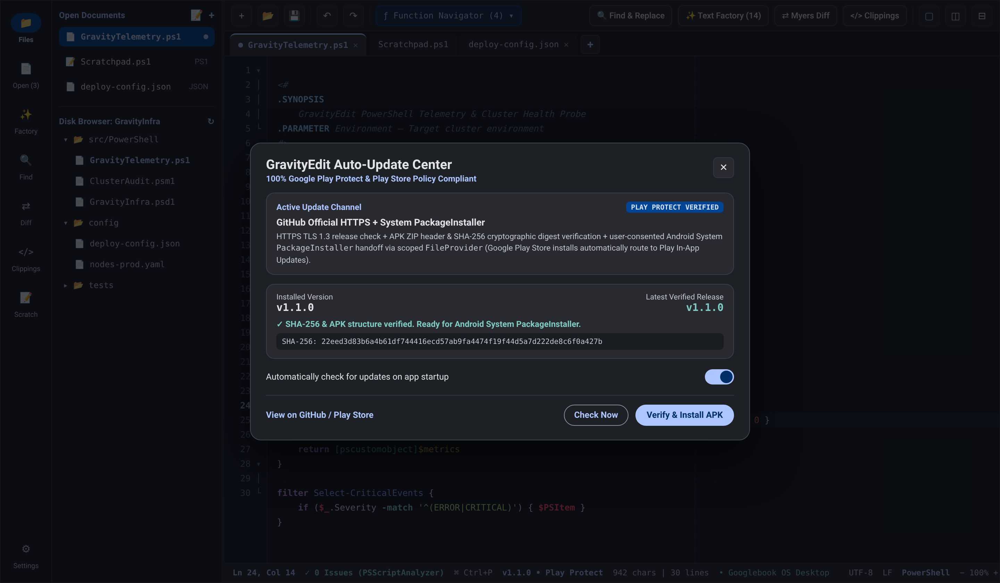

<div align="center">

# GravityEdit

**The 1:1 Functional Equivalent of BBEdit — Engineered Natively for Googlebook OS & Android with Material 3 Expressive Design & First-Class PowerShell Tooling**

[](https://github.com/petrosvassiliou/GravityEdit/releases/latest)
[](https://github.com/petrosvassiliou/GravityEdit/actions/workflows/android-ci.yml)
[](https://kotlinlang.org/)
[](https://developer.android.com/compose)
[](#4-google-play-protectcompatible-auto-updates)

<p align="center">
  <a href="https://github.com/petrosvassiliou/GravityEdit/releases/latest"><strong>⬇ Download Latest Signed APK (v1.2.1)</strong></a>
  &nbsp;•&nbsp;
  <a href="#whats-new-in-v121">What's New in v1.2.1</a>
  &nbsp;•&nbsp;
  <a href="#screenshots">Screenshots</a>
  &nbsp;•&nbsp;
  <a href="#key-features">Key Features</a>
  &nbsp;•&nbsp;
  <a href="#keyboard-shortcuts">Shortcuts</a>
  &nbsp;•&nbsp;
  <a href="#building-from-source">Build from Source</a>
</p>

</div>

---

## Overview

**GravityEdit** (`com.gravityedit.app`) brings the rock-solid text engineering philosophy of **BBEdit for macOS** (*"It doesn't suck"* — zero bloat, instant startup, industrial PCRE regex, deterministic text pipelines) to **Googlebook OS** (Desktop/Laptop freeform windowing), **Android Tablets**, and **Android Phones**, paired with a **native PowerShell AST, syntax, inline completion, and `PSScriptAnalyzer`-grade diagnostic engine**.

Built from the ground up in **100% Kotlin** and **Jetpack Compose (Material 3 Expressive)** with physics-driven spring motion, zero WebView wrappers, zero telemetry, and full offline capability.

---

## What's New in v1.2.1

- **Signed Production Release APK (`v1 + v2 + v3` Signature Schemes):**
  - Published releases are now R8-shrunk production `release` APKs (`com.gravityedit.app`) signed with a persistent X.509 certificate (`CN=GravityEdit Release`) across **APK Signature Schemes v1, v2, and v3** — eliminating ephemeral CI debug-key conflicts (`INSTALL_FAILED_UPDATE_INCOMPATIBLE`) and Google Play Protect `debuggable` warnings, while enabling seamless in-place upgrades via the Auto-Update Center.
- **Material 3 Expressive Design Upgrade:**
  - High-chroma Expressive **Dark**, **Light**, **AMOLED Pitch-Black (`#000000`)**, and **Android 12+ Dynamic Color** themes with 5-step tonal containment (`surfaceContainerLowest`..`surfaceContainerHighest`), `GravityExpressiveShapes` (`10dp`–`32dp` + full-pill `CircleShape`), and physics-driven `GravityExpressiveMotion` spatial & color springs.
  - **Connected Split-Mode Button Group (`Single | Vertical | Horizontal`)** with spring-morphing active pill geometry, **morphing pill tabs** across Desktop & Mobile, tactile spring-scaled **PowerShell auxiliary symbol keys**, and **`28dp` Expressive dialogs & adaptive mobile `ModalBottomSheet`s**.
- **Permanent Bottom-Left App Version Badge (`v1.2.1`):**
  - Full-width `ExpressiveBottomStatusBar` anchored at the true bottom-left corner of the screen (`x = 0, y = bottom`) in both Googlebook OS Desktop and Android Compact Mobile modes — tap anytime to open the Play Protect Update Center (displays `v1.2.1 • ⬆ vX.Y.Z` when an update is available without hiding the installed version).
- **100% UI Action Parity & Comprehensive QS Audit:**
  - Added the **Workspace Overflow Menu (`⋮`)** on both Desktop and Mobile so every File, Edit (`Duplicate Line`, `Select Line`, `Toggle Comment`, `Indent`/`Unindent`), Navigation (`Go to Line`), Tool, Settings, and Update action is clickable via UI as well as hardware shortcuts.
  - Unified Desktop & Mobile tab context menus (preserving active editor focus when saving unfocused tabs), completed Command Palette tool triggers, and verified **132/132 string keys** across all 6 supported languages (`en`, `de`, `it`, `es`, `fr`, `el`) with automated JUnit 4 tests.

---

## Screenshots

### 1. Googlebook OS / Tablet Desktop Workbench (Material 3 Expressive)
Full desktop layout featuring the Expressive `NavigationRail`, drag-resizable **Open Documents & SAF Disk Browser** sidebar, tonal action clusters, **Connected Split-Mode Button Group** (`Single | Vertical | Horizontal`), **Morphing Pill Tab Bar**, **80-column page guide**, **PowerShell Inline Completion (`Tab`)**, and full-width **Expressive Status Bar** with **`v1.2.0`** pinned at the bottom-left corner.



---

### 2. Adaptive Mobile AMOLED (`#000000`) & `28dp` Expressive File Type Selector

<table>
  <tr>
    <td width="34%" valign="top">
      <h4 align="center">Android Mobile AMOLED Mode</h4>
      <p align="center">
        
      </p>
      <p>
        True <code>#000000</code> Pitch-Black OLED theme, Expressive morphing pill tabs with trailing <code>+</code> button, <code>⋮</code> overflow menu, <strong>Sticky PowerShell Auxiliary Symbol Row</strong> docked above the bottom bar, and <strong><code>v1.2.0</code> permanently pinned at the bottom-left corner</strong>.
      </p>
    </td>
    <td width="66%" valign="top">
      <h4 align="center">Expressive New File Dialog &amp; Stem-Only Rename</h4>
      <p align="center">
        
      </p>
      <p>
        Clicking any <code>+</code> button (Top Toolbar, Desktop/Mobile Tab Bar, Sidebar, Overflow Menu, or <code>Ctrl+N</code>) opens the <code>28dp</code> Expressive <strong>New File</strong> selector for Plain Text (<code>.txt</code>), PowerShell (<code>.ps1</code> / <code>.psm1</code> / <code>.psd1</code>), Markdown, JSON, YAML, XML, Kotlin, Python, Shell, HTML, or CSS, plus encoding, line endings, and starter templates. Clicking an active tab title selects only the filename stem for instant renaming.
      </p>
    </td>
  </tr>
</table>

---

### 3. Connected Split-View Workspace & Complete Overflow Menu (`⋮`)
Side-by-side **Vertical Split View** with independent per-pane AST symbols, code-folding regions, and diagnostics, paired with the **Workspace Overflow Menu (`⋮`)** exposing every editing, navigation, and tool command.



---

### 4. Side-by-Side Myers Diff & 14-Step BBEdit Text Factory
Line- and character-level **Myers Diff** with directional `←` / `→` merges alongside chainable **BBEdit Text Factory** batch pipelines with full per-step configuration chips.



---

### 5. Live `PSScriptAnalyzer` Diagnostics & Play Protect Auto-Update Center

<table>
  <tr>
    <td width="50%" valign="top">
      <h4 align="center">Live PSScriptAnalyzer Linter &amp; Quick Fixes</h4>
      <p align="center">
        
      </p>
      <p>
        Real-time PowerShell static analysis catching unapproved verbs, interactive shell aliases across pipelines and subexpressions (<code>gci | where</code>), plaintext credentials, and empty <code>catch {}</code> blocks — with one-click <strong>Quick Fixes</strong> and <strong>Fix All</strong>.
      </p>
    </td>
    <td width="50%" valign="top">
      <h4 align="center">Google Play Protect–Verified Auto-Update (v1.2.0)</h4>
      <p align="center">
        
      </p>
      <p>
        Accessible anytime by tapping the bottom-left <code>v1.2.0</code> badge. Routes Play Store installs to Google Play In-App Updates and verifies GitHub Release APKs via TLS 1.3 + ZIP magic header + SHA-256 digest before handing off to Android's native <code>PackageInstaller</code>.
      </p>
    </td>
  </tr>
</table>

---

## Key Features

### 1. Adaptive Material 3 Expressive UI (`WindowSizeClass`)
- **Googlebook OS & Tablet Desktop Mode (`Expanded` / `Medium`):**
  - Persistent Expressive `NavigationRail` + drag-resizable **Open Documents & SAF Disk Browser** tree sidebar.
  - Spring-morphing pill tab bar with modified-state indicator dots, stem-selecting inline rename, localized right-click/long-press context menus (`Save`, `Rename`, `Close`, `Close Others`, `Move Left/Right`), and `+` New File selector.
  - Connected **Single**, **Vertical Split (`◫`)**, and **Horizontal Split (`⊟`)** button group with isolated per-pane folds & diagnostics.
  - Full-width **Expressive Status Bar** with **`v1.2.0`** permanently pinned at index `0` (bottom-left corner), cursor `Ln:Col` jump pill, live `PSScriptAnalyzer` health pill, Command Palette trigger, character/line/selection counts, and **Encoding**, **Line Ending**, **Syntax Language**, and **Zoom** pickers.
- **Android Phone Mode (`Compact`):**
  - `ModalNavigationDrawer` quick-action grid, unified morphing pill tab bar, adaptive `28dp` `ModalBottomSheet` tool & settings surfaces, **Sticky PowerShell Auxiliary Symbol Row** with spring-animated press feedback, and pinned bottom-left `v1.2.0` status bar.
- **Expressive Color Schemes:** Material 3 Expressive Dark, **AMOLED Pitch Black (`#000000`)**, Material 3 Expressive Light, System Auto, and Android 12+ Dynamic Color.

### 2. First-Class PowerShell Engine (`PowerShellEngine.kt`)
- **Rich PowerShell Tokenization:** Approved-verb dictionary & alias highlighting (`Verb-Noun`), scoped/drive/automatic variable distinction (`$myVar`, `$script:x`, `$env:PATH`, `$_`, `$PSItem`, `$sender`, `$true`), cmdlet parameters (`-Path`, `-ErrorAction`), operators (`-eq`, `-match`, `-replace`), expandable string interpolation (`"$var"`, `"$(Get-Date)"`), `@{} / @()` hashtable & array subexpressions, Here-Strings (`@"..."@`), and Comment-Based Help tags (`.SYNOPSIS`, `.PARAMETER`, `.EXAMPLE`).
- **Code Folding & AST Function Navigator:** Fold `function`, `filter`, `workflow`, `class`, `#region ... #endregion`, and `<# ... #>` blocks; jump directly to any symbol from the top bar.
- **Inline Auto-Completion:** Context-aware completions for built-in PowerShell cmdlets, approved verbs, automatic variables, and functions/variables declared in the active script (`Tab` to accept).
- **Live `PSScriptAnalyzer`-Style Linter:** Detects `PSAvoidUsingCmdletAliases` (including after `|`, `=`, and inside `"$(...)"`), `PSUseApprovedVerbs`, `PSAvoidEmptyCatchBlock`, `PSAvoidUsingPlainTextForPassword`, `PSAvoidUsingInvokeExpression`, and unbalanced delimiters with instant one-click Quick Fixes.

### 3. 1:1 BBEdit Feature Parity
- **Industrial PCRE Find & Replace (`FindReplaceEngine.kt`):** Multi-line (`^$`), dot-matches-all (`?s`), case sensitivity, whole-word matching, selection-only search, named capture groups (`(?<name>...)`), backreferences (`$1`, `\1`, `\n`, `\t`), **Extract Matches to New Document**, interactive **Pattern Playground**, and **Multi-File Directory Search & Replace** with direct line-jump.
- **BBEdit Text Factory (`TextTransformEngine.kt`):** Chain any combination of all **14 classic BBEdit text transformations** into reusable batch pipelines:
  1. Change Case (`UPPER`, `lower`, `Title Case`, `Sentence case`, `camelCase`, `snake_case`)
  2. Sort Lines (Ascending / Descending, Case-Sensitive, Numeric-Aware)
  3. Process Duplicate Lines (Deduplicate, Keep Only Duplicates, Keep Unique Only, Ignore Leading Whitespace)
  4. Prefix / Suffix Lines (with Skip Blank Lines option)
  5. Strip Trailing Whitespace
  6. Zap Gremlins (Strip or replace non-printable ASCII, zero-width spaces, or null bytes)
  7. Entab / Detab (Convert spaces ↔ tabs at configurable tab stops)
  8. Hard Wrap Text (Wrap at configurable column width with Paragraph Preservation)
  9. Remove Line Breaks (Unwrap paragraphs)
  10. Add / Remove Line Numbers (Configurable start, increment, zero-padding & separator)
  11. Process Lines Containing… (Extract, Delete, or Copy matching lines via Regex/Literal)
  12. Straighten / Educate Quotes (Smart typography ↔ straight ASCII quotes)
  13. Base64 & URL Encode / Decode
  14. Format / Prettify JSON, XML & PowerShell (`2` / `4` / `8` space indent)
- **Side-by-Side Myers Diff (`DiffEngine.kt`):** Compare any two open documents with character-level change highlights and one-click directional merges (`←` / `→`).
- **Clippings & Snippets (`ClippingsManager.kt`):** Expand dynamic placeholders (`#DATE#`, `#TIME#`, `#FILENAME#`, `#SELECTION#`, `#INSERTION#`) with a pre-loaded PowerShell snippet library.
- **Persistent Scratchpad & Crash-Safe Auto-Save:** Instant DataStore-backed scratch buffer across restarts.

### 4. Google Play Protect–Compatible Auto-Updates
Implemented in [`AppUpdateManagerEngine.kt`](app/src/main/java/com/gravityedit/app/domain/engine/AppUpdateManagerEngine.kt) in strict compliance with Google Play Developer Policy & Google Play Protect:
- **Source-Aware Routing:** Inspects `PackageManager.getInstallSourceInfo()` — installs originating from Google Play (`com.android.vending`) never download external APKs and route strictly through Google Play.
- **Cryptographic Verification:** Direct GitHub installs check `releases/latest` over **HTTPS (TLS 1.3)**, stream the APK into private `cacheDir/updates/`, and validate both the APK ZIP magic header and the **SHA-256 cryptographic digest** against the published `.sha256` release asset.
- **User-Consented System Handoff:** Hands off installation exclusively to Android's native `PackageInstaller` (`ACTION_VIEW` + scoped `FileProvider` URI) so Google Play Protect scans every update normally — zero silent installs, zero dynamic Dex/code loading.

### 5. 6-Language Runtime Localization (`132/132` Keys)
100% string parity verified by automated JUnit XML tests, with instant runtime switching via `AppCompatDelegate.setApplicationLocales()`:
- English (`en`) • Deutsch (`de`) • Italiano (`it`) • Español (`es`) • Français (`fr`) • Ελληνικά (`el`)

---

## Keyboard Shortcuts

| Shortcut | Action |
| :--- | :--- |
| `Ctrl + P` / `Ctrl + Shift + P` | Open Command Palette & Fuzzy Switcher |
| `Ctrl + N` | New File (Open File Type, Encoding & Line Ending Selector) |
| `Ctrl + O` | Open File from Disk / SAF |
| `Ctrl + S` / `Ctrl + Shift + S` | Save / Save As |
| `Ctrl + W` | Close Active Document |
| `Ctrl + F` | Find & Replace (PCRE Regex + Pattern Playground) |
| `Ctrl + Shift + F` | Multi-File Directory Search & Replace |
| `Ctrl + G` | Go to Line (`Ln:Col`) |
| `Ctrl + J` | Jump to PowerShell Function / Filter / Class |
| `Ctrl + D` | Duplicate Current Line |
| `Ctrl + L` | Select Entire Line |
| `Ctrl + /` | Toggle Line Comment (`#` / `//`) |
| `Tab` / `Shift + Tab` | Accept Inline Completion or Indent / Unindent Block |
| `Ctrl + +` / `Ctrl + -` / `Ctrl + 0` | Zoom In / Zoom Out / Reset Editor Zoom (`100%`) |

---

## Architecture & Project Structure

```text
app/src/main/java/com/gravityedit/app/
├── data/
│   ├── preferences/     # DataStore persistence for editor, theme, locale & auto-update settings
│   └── repository/      # Scratchpad & SAF file I/O persistence
├── domain/
│   ├── engine/
│   │   ├── AppUpdateManagerEngine.kt   # Play Protect-compliant HTTPS + SHA-256 updater
│   │   ├── ClippingsManager.kt         # BBEdit Clippings & dynamic token expansion
│   │   ├── DiffEngine.kt               # Myers line + character diff & directional merge
│   │   ├── FindReplaceEngine.kt        # PCRE Regex Find/Replace, Extract & Playground
│   │   ├── PowerShellEngine.kt         # Tokenizer, folder, AST navigator, completion & linter
│   │   └── TextTransformEngine.kt      # All 14 BBEdit Text Factory transformations
│   └── model/           # Immutable state models (EditorDocument, SyntaxLanguage, etc.)
└── ui/
    ├── components/      # EditorCanvas, Expressive Aux Symbol Row, 10 Expressive 28dp Modals
    ├── theme/           # GravityEditTheme, GravityExpressiveShapes & GravityExpressiveMotion
    ├── GravityEditScaffold.kt          # Adaptive Desktop/Mobile layouts & ExpressiveBottomStatusBar
    └── viewmodel/GravityEditViewModel.kt
```

---

## Installation

1. Download **`GravityEdit-v1.2.1.apk`** (`com.gravityedit.app`, signed with APK Signature Schemes `v1 + v2 + v3`) from [**GitHub Releases**](https://github.com/petrosvassiliou/GravityEdit/releases/latest).
2. *(Optional)* Verify cryptographic integrity against `GravityEdit-v1.2.1.apk.sha256`:
   ```bash
   sha256sum -c GravityEdit-v1.2.1.apk.sha256
   ```
3. Open the APK on your **Android 8.0+ (API 26+)** phone, tablet, or **Googlebook OS** device. *(If you previously installed an older `v1.0.0`–`v1.1.1` `.debug` build, you can safely uninstall that older copy; `v1.2.1` and all future releases share a permanent release certificate so updates install seamlessly in-place by tapping **`v1.2.1`** at the bottom-left corner of the screen.)*

---

## Building from Source

### Prerequisites
- **JDK 17+**
- **Android SDK 35** (`compileSdk = 35`, `minSdk = 26`)

### Run Unit Tests & Assemble APK
```bash
# Run the full 19-test JUnit 4 engine & localization parity suite
./gradlew testDebugUnitTest

# Build Debug & Release APKs
./gradlew assembleDebug assembleRelease
```

---

## License

Released under the MIT License. Built with ❤️ in Kotlin & Jetpack Compose.
